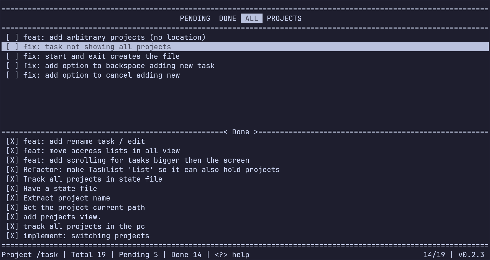

# Task

Simple task tracker TUI written in C.
Nothing fancy, just a simple interface to quickly add or mark tasks in a `.tasks.txt` file.



## Install

Compile and copy to path:

```Bash
make
cp task ~/.local/bin/
```

## Usage

```Bash
task # use --help to see options
```

On creating first task in a project it creates a `.tasks.txt` in cwd, and appends the project to its
state file. Press <kbd>?</kbd> to see keys.

## License

[GPL-3](LICENSE)
